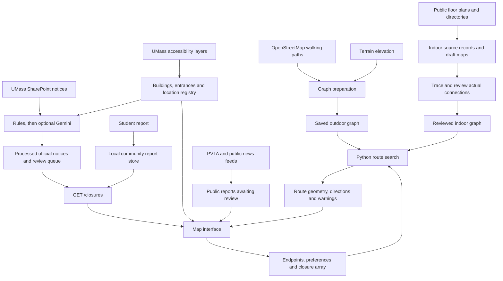
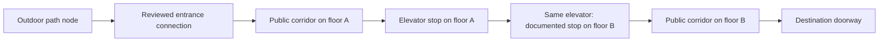

# CampusNav: how the application works

Latest validation and exact missing floor/connection evidence:
[Indoor data needed](INDOOR_DATA_NEEDED.md), with a
[floor-by-floor coverage audit](INDOOR_COVERAGE_AUDIT.md).

Residence work now has an [all-dorm preparation and validation guide](RESIDENCE_NAVIGATION.md).
The batch workflow covers 51 distinct downloaded residence buildings and preserves Brown's
existing draft work. Guided navigation now supports additional imported building maps.

Implementation and local data checked on November 14, 2026. This describes the current
workspace, not a deployed campus service. Counts and source freshness change after refreshes.

CampusNav calculates a walking route using a saved map of paths, the user's preferences,
and a list of reported disruptions. Separate background scripts collect and process source
data. The route calculation itself never waits for scraping or Gemini.

**Indoor routing is possible, and its backend is implemented.** Real UMass floor-plan
references are available, but the connections through corridors, doors and elevators have
not yet been entered and reviewed. The current user-facing map calculates outdoor routes.
This document describes the remaining indoor work without implementing frontend code.
The new [guided library–ILC API](GUIDED_NAVIGATION.md) implements location questions,
departure, outdoor travel, arrival confirmation and indoor continuation. The
[indoor-source investigation](INDOOR_SOURCE_AUDIT.md) records what the interactive map and
other public sources supply. This addition is limited to Roles 1 and 3.
The separate Role 4 service is reviewed in [BACKEND_HANDOFF.md](BACKEND_HANDOFF.md): it
supports Atlas, but our local app is not yet wired to it and indoor IDs/freshness fields
need alignment before swapping its feeds into this application.

## 1. What works today

| Capability | Current state |
| --- | --- |
| Outdoor routing | Real OSM walking graph: 6,885 nodes and 15,618 directed edges; estimated terrain grades are attached to edges |
| Building selection | 7 buildings in the catalog; 5 offered as destinations in the routing area |
| Entrance information | 12 entrance positions, with sourced door/access information where available |
| Elevator information | 8 mapped locations; these are not necessarily 8 individual elevator cars, and do not establish floors served |
| Preference route and comparison | Python chooses feasible outdoor approaches to entrances and returns a preference route plus a shortest-route comparison |
| Official notices | Authenticated SharePoint scraper, deterministic parser, optional Gemini fallback, cached output and review queue |
| Community reports | Report/confirm/resolve flow backed by a local JSON file; active reports expire after 24 hours unless confirmed again |
| Public complaints | PVTA/news discovery and display of review candidates; no automatic conversion into closures |
| Indoor sources | 155 references: 26 library floor images, 27 library service/floor records, 24 Campus Center room records, 16 ILC classrooms, 57 pilot restrooms and 5 ILC study spaces |
| Indoor routing backend | Floor-specific paths, elevator/stair transitions, scoped closures, and combined outdoor/indoor journeys |
| Guided library–ILC backend | Starting-location clarification, staged trips, arrival confirmation, refreshed closures and indoor continuation |
| Real indoor campus routes | Not enabled: library, ILC and Campus Center maps are drafts with no corridor edges or outdoor entrance connections |
| Indoor frontend | Not implemented; the API and written handoff are ready for Role 2 |
| MongoDB Atlas | Planned Role 4 integration; the running Python app currently reads/writes local files |

The five routing destinations are Campus Center, ILC, Student Union, Du Bois Library and
Goodell. Patterson and Grayson are included to locate notices, but are outside this walking
graph. The coverage box is longitude -72.536 to -72.519, latitude 42.3835 to 42.3955.
A point inside the box can still lack a connected route under the selected constraints.

## 2. The complete data flow



The reviewed-indoor branch is supported by code but has no real campus topology published
yet. Public review candidates do not feed into the active-closure branch automatically.

There are two different update speeds. The interface checks saved closures every **15 seconds**.
Notice and public-report workers refresh their sources **hourly when started with `--watch`**.
Opening the app does not start those workers. Indoor sources have a separate manual refresh.

### When someone requests a route

1. The browser loads building data, graph health, and the current closure list.
2. The user selects buildings or map pins and adjusts preferences.
3. The browser sends `POST /plan` with the endpoints, preferences and closures.
4. The backend considers eligible mapped entrances, applies restrictions to the walking
   graph, and runs Dijkstra's shortest-path search. A graph is simply places connected by
   paths: a node is a place, and an edge is a path between places.
5. Closed edges are removed. Degraded edges have five times their distance as search cost,
   making the router prefer a reasonable alternative. Stairs and excessive grades are
   filtered according to the request. Constraints are never silently relaxed.
6. The backend returns a GeoJSON line, distance, maximum estimated grade, instructions and
   warnings. The browser draws it. Changing a preference, endpoint, or detected closure list
   triggers another calculation.

`/plan` also calculates a comparison route with stairs/grade preferences relaxed but the
same closures applied. Its `accessible` response name means the route meets the implemented
filters; it is not a certification of accessibility. Unknown entrance access is still
possible in the outdoor catalog and is reported to the user.

The currently connected outdoor controls are maximum grade, no stairs (also enabled by the
wheelchair preference), and powered-door entrance selection. Other preferences in inherited
frontend types, such as handrails or indoor preference, do not imply an implemented backend
filter. Displayed travel duration is a simple distance-based estimate, not measured travel
time or a prediction of elevator waiting time.

Routes are calculated against the **saved graph plus the closure array in that request**.
They are not calculated against a floor-plan picture, Google directions, or Gemini output.
Calling a route endpoint with `closures: []` deliberately excludes current disruptions;
clients must fetch and forward the closure list.

### When a student reports an issue

The Report button sends `POST /reports`. A broken/blocked report becomes a closed community
issue; an under-repair report becomes degraded. A confirmation extends expiry by 24 hours.
A working report removes matching community issues and does not clear an official notice.
Indoor reports also preserve their building, floor and asset scope.

`GET /closures` combines active official and community records. The originally proposed
12-hour conflict-priority policy is not implemented: the current merger does not reconcile
every official/community contradiction. MongoDB TTL indexes are not used by this local store.

The **Demo -> Simulate blocked path** action injects a temporary closure into this browser's
route request. It does not save a fictional student report. On the current graph, the initial
Campus Center-to-library trip is 461.26 m; the existing demo changes it to 607.15 m.

## 3. How the scraper and Gemini work

The official worker first fetches the UMass SharePoint list using the operator's saved,
authorized session. It processes complete paginated results and retains the previous snapshot
if collection fails. Its normal fallback order is:

1. Live SharePoint scrape.
2. Last complete successful raw scrape.
3. Downloaded spreadsheet, only if live access and the saved scrape are unavailable.
4. Retain previous processed output and report failure if none is usable.

The spreadsheet is not the primary source. `--spreadsheet PATH` is a deliberate offline-only
override; normal refresh commands do not use that override.

The parser first uses deterministic phrase/regex rules and explicit service states. This
serves the role of the proposed DFA-style approach, although it is not a general formal-DFA
parser. If the wording is ambiguous, optional Gemini extraction can return structured fields.
Its output still passes validation. The reviewed location registry supplies coordinates;
neither rules nor Gemini may invent an elevator position or a floor connection.

Ambiguous assets, incomplete times and unsupported claims go to a review queue. A valid
scheduled outage can be published but stays out of `/closures` until its start time. The
`/notices` endpoint also exposes upcoming mapped notices. Missing reports do not prove that
all campus facilities are operating.

Gemini runs only on the ingestion worker, with cached extractions and a call budget. The
official worker defaults to at most 25 new calls per refresh; the public-report worker defaults
to 10. `--rules-only` disables calls. The last checked official refresh used zero Gemini calls;
live model access has not been established by the integration checks. Browser route narration
currently uses templates, despite a legacy filename containing `geminiService`.

Students using the app do not need SharePoint access. The operator running the scraper signs
in and later renews that session when it expires. A teammate running a separate scraper uses
their own authorized account. An unattended hosted worker would need an approved authentication
setup; this prototype does not implement that deployment.

## 4. Data sources and what each actually gives us

| Source | Data we obtain | Where it is used / limitation |
| --- | --- | --- |
| [OpenStreetMap / Overpass](https://overpass-api.de/api) | Walking geometry, path/stair tags, available access and entrance tags | Main outdoor graph, built with OSMnx. Missing tags and indoor gaps remain unknown. |
| [Open Topo Data NED 10m](https://www.opentopodata.org/datasets/ned/) | Terrain elevation at graph nodes | Approximate slope: elevation change divided by path length. This does not measure individual ramps or establish accessibility compliance. |
| [UMass ArcGIS accessibility map](https://www.arcgis.com/apps/instant/basic/index.html?appid=4575634567794afd863c83bc4d6d6d4a) | Building footprints, entrance coordinates, door-opener/keycard flags and elevator locations | Catalog and asset registry. Source labels say August 2022; an elevator point does not provide operating status or all floor stops. |
| [UMass interruption notices](https://umass.sharepoint.com/sites/impactnotices/Lists/Service%20Interruption%20Notices/Current%20Interruptions.aspx) | Building, issue description, category and effective dates/times | Official outages after validated parsing and location matching. Operator sign-in required. |
| [Du Bois floor directory](https://www.library.umass.edu/du-bois-library/) | Explicit floor-to-service associations | 27 source records. These identify useful destinations but not paths to them. |
| [Library floor-map index](https://umass.stackmap.com/explore/) | Floor label and image URL | 26 Du Bois references. Images need tracing, scale evidence and elevator-stop review before routing. |
| [Campus Center room directory](https://www.umass.edu/af/space-use/campus-center) | Rooms paired with explicitly named floors | 24 records across 6 floor labels. Does not supply our corridor graph or room-door positions. |
| [ILC classroom directory](https://www.umass.edu/registrar/room-types-and-capacities-ilc) | Room IDs, capacity/type, details and explicit entry-floor notes | 16 rooms. N151 explicitly has two entry floors; other floors are not inferred from room numbers. |
| [UMass Restrooms layer](https://services.arcgis.com/2gdL2gxYNFY2TOUb/arcgis/rest/services/Restrooms/FeatureServer/0) | Room, explicit floor, coordinates and original access fields | 57 library/ILC records. Staff-only descriptions remain marked; a room point does not establish a public path. |
| [UMass study-spaces layer](https://services.arcgis.com/2gdL2gxYNFY2TOUb/arcgis/rest/services/Campus_Buildings_StudentStudySpaces_View/FeatureServer/0) | Explicit floor, room and geographic position | 5 ILC references. Source N201 floor `01` is preserved, illustrating why room-number floor inference is unreliable. |
| [PVTA alert feed](https://pvta.us/swiftly/RevizeAlerts2.php) | Alert text and affected transit routes | Public review candidates; a bus detour does not automatically close a walking path. |
| [Daily Collegian RSS](https://dailycollegian.com/feed/) | Article titles, snippets, publication times and links | Recent relevant reports for review; zero matching articles is a valid result. |
| [r/umass](https://www.reddit.com/r/umass/) | Adapter supports recent posts/comments through authorized API access | Not configured, currently contributes no reports. |
| Facebook Page feed | Adapter supports a selected Page through authorized API access | Not configured; no Page/token selected. No private-group scraping. |
| Direct student reports | Selected location/asset, problem state and timestamp | Local community closure store, with expiry and confirmations. |
| Downloaded spreadsheet | Previously exported official notice fields | Last-resort fallback, clearly labeled; default path is `~/Downloads/Book1.xlsx`. |
| [OSM map tiles](https://tile.openstreetmap.org/) | Visual map background | Display only. They do not compute routes; background tiles normally require internet. |

The exact imported ArcGIS layers are [BuildingData/0](https://services.arcgis.com/2gdL2gxYNFY2TOUb/arcgis/rest/services/BuildingData/FeatureServer/0),
[Entrances/0](https://services.arcgis.com/2gdL2gxYNFY2TOUb/arcgis/rest/services/Entrances/FeatureServer/0),
and [Elevators/0](https://services.arcgis.com/2gdL2gxYNFY2TOUb/arcgis/rest/services/Elevators/FeatureServer/0).
They supply positions and attributes; we do not derive real coordinates from a campus screenshot.

The older campus accessibility PDF is a contextual reference, not an additional automated
data feed in the current pipeline. The previously located ILC manual URL redirected to a
general university page and was not imported as a floor plan. More sources can improve
coverage, but overlapping or ambiguous descriptions need matching rather than being counted
as independent proof.

### Snapshot observed during this documentation pass

| Dataset | Last successful fetch reflected in local data | Observed result |
| --- | --- | --- |
| Official notices | Nov 14, 2026, 01:17 EST | 1,095 imported notices; 2 published upcoming inspections; 1 review item; 0 active at the check |
| Public reports | Nov 14, 2026, 01:13 EST | 3 saved review candidates; PVTA and Collegian fetched, social adapters unconfigured |
| Indoor references | Nov 14, 2026; exact observation time in `data/indoor_sources.json` | 155 records from six successful sources; library, ILC and Campus Center drafts, none routable |
| Building catalog | Nov 14, 2026, 01:13 EST | 7 buildings, 12 entrances, 8 elevator locations; source edition August 2022 |

The official and public status endpoints already marked their snapshots **stale** during this
check. A stored `mode: live` means the last fetch succeeded, not that it is still fresh now.
Do not present these counts as current outages after the snapshot ages.

For official data, the implementation marks the snapshot stale after two hours, when a source
observation is older than 24 hours, or when fallback/failure conditions apply. A scraper
timestamp means the source was read; a student confirmation timestamp means someone submitted
a confirmation. Neither is equivalent to a staff inspection. Public posts retain their original
age; repeated collection does not make an old complaint new.

See [DATA_SOURCES.md](../DATA_SOURCES.md) for the detailed field inventory and
[PUBLIC_REPORTS.md](PUBLIC_REPORTS.md) for source configuration and review rules.

## 5. How we enable real indoor routing

### Why it is feasible

The library's actual [first-floor image](https://umass.stackmap.com/media/maps/1st-e-populated.png)
was inspected for this guide. It is a 1270 x 1500 image with walls/openings, elevator symbols,
stairs, emergency exits and a staff-only area. This supports beginning a trace of public
interior connections. No metric scale was visible, and this single image does not establish
elevator identity across floors, door width/opener type, or current access.

An image is a background. Routing needs explicit connected paths over that background:



The backend already understands this structure. Two points at the same x/y on different
floors remain separate unless an elevator, stair or ramp edge explicitly connects them.
The next implementation task is therefore **creating reliable map data**, followed by
Role 2 consuming the existing API. It does not require replacing the routing algorithm.

### Recommended pilot: one entrance, two public floors, one destination

Start with a small Du Bois Library area because floor images and a directory are already
available. Choose the exact floors after checking their public access and actual elevator
service. Do not start by promising all 26 floors or a specific room whose doorway is not mapped.

| Step | Work and output | Owner |
| --- | --- | --- |
| 1. Identify sources | Select two usable drawings; record source URLs, floor labels, image dimensions and revision information when available | Role 3 |
| 2. Resolve missing facts | Establish scale, public entrance, elevator identities/stops and relevant access attributes from drawings, records or measurements | Role 3 with a source reviewer |
| 3. Trace paths | Mark entrance thresholds, corridor junctions, destination doors and elevator stops; connect only genuinely walkable space | Role 3, using the Role 1 data contract |
| 4. Attach outside | Bind the indoor entrance to an actual outdoor graph node with a sourced entrance-approach line | Role 1 |
| 5. Validate | Check topology, restrictions, directionality, lengths, floor changes and asset IDs; test closure effects | Roles 1 and 3 |
| 6. Publish | Import reviewed real geometry and export its located asset IDs into the outage registry | Roles 1 and 3 |
| 7. Display | Implement floor selection, plan background and route/transition display using the published endpoints | Role 2; frontend work remains outside this change |

Manual tracing is sufficient for a small pilot. Someone can inspect a drawing, record pixel
coordinates with an image tool, and enter nodes and polylines into JSON. A custom drawing
editor is optional, not a prerequisite. Source review can be based on reliable plans and
records; record field verification separately rather than claiming it happened.

### Facts we must establish before publishing

| Required fact | Why / how it is represented |
| --- | --- |
| Floor identity | Keep explicit floor IDs. The directory's `E`/`LL` labels and plan site's `1st Floor`/`Lower Level` labels must be reconciled with evidence. |
| Public walkable connections | A polyline must remain in open public space and cross walls only at mapped doors. An emergency exit symbol alone does not establish a normal public entrance. |
| Distance scale | Pixel distances are not meters. Use a documented plan scale or reliable measured dimensions; retain evidence for the conversion. |
| Doors and restrictions | Record public access, known step-free status, grade, width and opener type. A visible opening alone does not establish all of these. |
| Elevator identity and stops | Associate stops with the same documented shaft/bank. Matching icons or approximate x/y positions alone are insufficient. |
| Outdoor connection | An entrance needs a geographic position and actual approach path ending at an existing walking-graph node. |
| Source/review record | Each mapped element references its evidence; the map records review time and notes. |

The current contract requires positive `length_m` for each connection, including floor
transitions. If reliable lengths or scale are unavailable, keep the graph in draft rather
than enter arbitrary meter values. If supporting unknown distances becomes necessary, that
requires an explicit backend contract/cost change; it is not implemented today.

UMass publishes a [floor-plan drawing-request process](https://www.umass.edu/facilities/service-space-requests)
that asks for the building, floor, reason and deadline. This is a route to missing drawings;
it is not an existing automatic feed, and no request has been sent by this application.

Combining sources helps: the floor plan provides interior shape, the directory identifies
destinations, ArcGIS provides entrance/elevator positions, and notices describe disruptions.
None of those facts alone proves a complete traversable route.

### What the existing indoor JSON stores

| Collection | Plain-language meaning |
| --- | --- |
| `sources` | Where the information came from and when it was observed |
| `floors` | Floor IDs, labels, image URLs and coordinate systems |
| `nodes` | Rooms, entrances, junctions and elevator/stair stops with x/y on a named floor |
| `edges` | Traversable connections, shape, length, restrictions and evidence |
| `assets` | Named elevator/ramp/path identities that closures can target |
| `portals` | Reviewed entrance approaches connecting indoor nodes to specific outdoor nodes |

Floor x/y coordinates may be image pixels or local meters. Outdoor coordinates are
longitude/latitude. A client must not draw indoor pixels as geographic GeoJSON coordinates.
Same-floor segments carry their coordinate system; transitions identify both floors and stops.

The authoritative schema is [indoor-map.schema.json](../contracts/indoor-map.schema.json).
The complete [example map](../examples/indoor/demo-building.json) is fictional and useful for
understanding the structure, not as evidence about a campus building.

After a real file has been traced and reviewed, the existing publication commands are:

```powershell
# Replace the example input path with the completed real map file.
.\.venv\Scripts\python.exe -m scripts.import_indoor path\to\reviewed-library.json
.\.venv\Scripts\python.exe -m scripts.export_indoor_assets data\indoor\library.json
.\refresh-notices.cmd --rules-only
```

Do not merely change a draft's status flag. The importer checks references and entrance-node
bindings; a source review must establish the facts the schema cannot verify from JSON.
Draft and synthetic maps are rejected for production routing. Scraping fresh floor references
does not overwrite a manually edited draft or a published map.

### How an indoor outage causes a detour

Give a real elevator a stable `asset_id` and use that same ID on its floor-transition edges
and reviewed notice-registry entry. A parsed outage then carries `building_id`, `asset_id`
and optionally `floor_id`. Closing the whole asset removes its mapped transitions; a
floor-specific issue affects connections touching that floor. Unknown exact IDs do not
silently snap to another elevator.

The indoor engine searches the remaining connections. If a second usable elevator is
actually mapped, it may choose that alternative. If there is none, it returns no feasible
route. A real pilot does not need a second elevator to demonstrate correct failure handling.
An unmapped or ambiguous notice remains a warning/review issue, not a guessed detour.

The existing synthetic test demonstrates 14 m via elevator A, 34 m after A closes, and no
step-free route when both elevators close. Real distances must come from the real map.

### How we know the pilot is ready

The route follows the drawing without wall crossings, excludes staff-only areas, uses only
documented elevator stops and reaches the intended doorway. The outdoor entrance connection
reaches its declared graph node. Closing a named asset removes that asset's connections;
closing every usable elevator does not cause a silent stairs fallback. A floor-specific
issue does not close unrelated floors. Every unknown attribute remains explicit.

The strict indoor defaults exclude unknown step-free access and unknown walking grade when
those constraints apply. Explicit allow-unknown options keep uncertainty warnings. Width
requirements need known widths; the current outdoor graph lacks width coverage, so demanding
a minimum width can prevent a combined journey.

This pilot provides routes between selected places. Live indoor blue-dot positioning,
building opening-hours logic, automatic floor detection and elevator wait predictions are
separate features and are not implemented.

OCR or Gemini could later suggest labels or candidate connections for review. Current code
does not convert floor-plan images into paths automatically. A text parser cannot establish
wall openings, usable width or elevator service from a maintenance notice.

## 6. API and Role 2 handoff

An endpoint is simply a URL that the frontend calls to request data or a calculation.

| Endpoint | What the caller receives or submits |
| --- | --- |
| `GET /health` | Graph source, synthetic flag, node/edge counts |
| `GET /buildings` and `/buildings/status` | Catalog, entrances, elevator locations and source metadata |
| `GET /closures` and `/closures/status` | Active official/community issues and freshness information |
| `GET /notices` | Mapped official notices, including scheduled ones |
| `GET /official-closures` and `/official-closures/status` | Official-only closure contract and source status |
| `POST /route` | Outdoor point-to-point route from start/end coordinates, preferences and closures |
| `POST /plan` | Current building-aware outdoor comparison used by the map interface |
| `POST /reports` | Student observation; returns the recorded result |
| `POST /reports/{id}/confirm` | Renew an active community report |
| `GET /external-reports` and `/external-reports/status` | Public review candidates and collection status |
| `GET /indoor/sources` | Scraped floor references and their source/cache metadata |
| `GET /indoor/status` | Buildings with floor counts, draft/reviewed state and a routable flag |
| `GET /indoor/maps/{building_id}` | Floor images plus any mapped nodes, edges, assets and portals |
| `POST /indoor/route` | Same-building route between mapped node IDs |
| `POST /journey` | Ordered outdoor, entrance and indoor legs for selected endpoints |
| `GET /navigation/catalog` | Pilot building coverage, floors, reviewed landmarks and source references |
| `POST /navigation/resolve` | Resolve a library/ILC description or ask for clarification |
| `POST /navigation/plan` | Clarify missing positions or return staged indoor/outdoor travel |
| `POST /navigation/arrive` | Confirm arrival outside, ask about going inside and recompute the continuation |

Indoor routing requests must include actual mapped node IDs. `/journey` endpoints are
either outdoor coordinates or indoor building/node IDs. The response separates geographic
outdoor/entrance lines from floor-local indoor segments and includes floor-transition steps.
As with `/route`, callers supply the closures to these endpoints.

The guided `/navigation/*` endpoints accept descriptions and ask questions instead of
guessing locations. A floor alone requires a landmark. Omitted/null `closures` reads the
server snapshot each time; an explicit array overrides it. The guided workflow returns
`needs_input`, `route_ready`, `coverage_unavailable`, `no_route` or `arrived`; expected
workflow results use HTTP 200. See [GUIDED_NAVIGATION.md](GUIDED_NAVIGATION.md) for exact
requests and arrival handling. Real draft coverage is still reported as unavailable.

Role 2's remaining work is a floor selector, a floor-image view, selecting mapped destinations,
drawing local coordinates, and showing elevator/floor transitions. It should use `/indoor/status`
to distinguish displayable drafts from routable maps. No frontend implementation is included
in this documentation change. Detailed contracts are in [INDOOR_MAPPING.md](INDOOR_MAPPING.md).

Common responses: `422` means the input is invalid; `404` can mean an unmapped resource or
no feasible route, distinguished by the response's error code; `409 indoor_not_ready` means
the selected indoor map is still a draft; `503` means required graph/cache data is unavailable.
Swagger's list of possible Responses is documentation. The Server response after Execute
is the result of the actual request.

## 7. Running the current application

From the project folder in PowerShell:

```powershell
.\start-server.cmd
```

Keep that terminal open and visit [the app](http://127.0.0.1:8000).
Use [API docs](http://127.0.0.1:8000/docs) for endpoint testing or
[backend diagnostics](http://127.0.0.1:8000/backend) for the simpler test page.
If the server is already running, open the URL rather than launch another copy on port 8000.

In separate terminals, start the source workers:

```powershell
.\refresh-notices.cmd --rules-only --watch
```

```powershell
.\refresh-reports.cmd --rules-only --watch
```

If the UMass session expires, run `.\login-notices.cmd`, complete sign-in yourself in the
helper window, and follow its terminal verification prompt. The current app can keep using
the prior scrape while access is restored. Stop a worker with Ctrl+C.

Refresh indoor reference data on demand:

```powershell
.\refresh-indoor.cmd
```

Graph preparation and catalog import are separate setup/update operations:

```powershell
.\build-campus.cmd
.\.venv\Scripts\python.exe -m scripts.sync_campus_access
```

Rebuilding the graph may change node IDs, requiring indoor entrance bindings to be rechecked.
Restart the API after replacing the outdoor graph: it loads that graph at startup.
The launcher uses the real graph when available; if it selects a demo file, `/health` exposes
`synthetic: true`. Demo output must not be described as a real campus route.

Saved graph calculations and processed snapshots do not require internet. Fetching new
source data, map tiles and the remotely linked floor-plan images does. The indoor scraper
caches references, not an offline copy of every floor image.

## 8. Where the implementation and data live

| File or folder | Responsibility |
| --- | --- |
| `campus_routing/engine.py` | Outdoor graph filtering, coordinate snapping, closure effects and route search |
| `campus_routing/buildings.py` | Building/entrance selection and comparison routes |
| `campus_routing/indoor.py` | Indoor contracts, graph validation and floor-aware routing |
| `campus_routing/journey.py` | Combines indoor/outdoor legs through reviewed entrances |
| `campus_routing/places.py` | Deterministic building/floor/landmark resolution and clarifications |
| `campus_routing/navigation.py` | Stateless departure, outdoor travel, confirmed arrival and continuation |
| `campus_notices/indoor_sources.py` and `indoor_arcgis.py` | Six public indoor reference sources with complete-cache fallback |
| `campus_routing/api.py` | HTTP endpoints and serving the built map interface |
| `campus_notices/` | Official/public scraping, rules, optional Gemini, caches and community storage |
| `scripts/` | Graph building, source refreshes, imports, schema exports and demonstrations |
| `frontend/` | Teammate's React interface and adapter to the Python API |
| `contracts/` | Shared request/map schemas generated from backend models |
| `data/umass.graph.json` | Current real outdoor walking graph |
| `data/buildings.json` | Building, entrance and elevator-location catalog |
| `data/location_registry.json` | Reviewed source phrases matched to located assets |
| `data/official_snapshot.json` | Authoritative processed official notice snapshot |
| `data/official_snapshot.review.json` | Official items requiring source/location/time review |
| `data/indoor_sources.json` | Collected floor/room references and per-source status |
| `data/indoor/*.json` | Draft or reviewed building maps; API exposes their status |
| `data/private/` | Saved authentication state, raw notices, community reports and public-report snapshot |
| `.cache/` | Build/download and optional model-extraction caches |
| `examples/` | Isolated synthetic test/demo data |

Credentials stay in the ignored backend `.env`; session files and raw/private data must not
be copied into the frontend or shared as setup files. The location registry records source
matches, not student authentication. Student authentication, report abuse controls and a
production deployment remain separate work.

The frontend is a local clone of `MishraAsh2007/CampusNav` based on `role-2-map-ui` with local
integration changes. The Python project sits outside that nested repository. Pushing only
the frontend repository would not deliver the Python backend, its scripts or its contracts.

The guided-navigation and expanded-scraper validation passed 186 Python tests and Ruff.
The previous frontend integration passed 6 frontend tests and its build; the current
Role 1/Role 3 addition did not change frontend code or rerun frontend checks. The public
scraper fetched all six sources successfully. Current real indoor coverage remains zero
routable buildings; the complete guided demonstration uses isolated fictional layouts.

For operational details use [INTEGRATION.md](INTEGRATION.md); for official ingestion use
[ROLE3.md](ROLE3.md); for indoor contracts and examples use [INDOOR_MAPPING.md](INDOOR_MAPPING.md).
