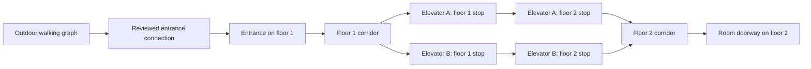

# Indoor mapping: Role 1 and Role 3 handoff

For the latest all-dorm preparation, Brown review findings, and imported-building routing
support, see [Residence navigation](RESIDENCE_NAVIGATION.md). The 56 source folders group
into 51 distinct residence buildings; private workspaces cover 349 source floor references.

See [the full application guide](APPLICATION_GUIDE.md#5-how-we-enable-real-indoor-routing)
for the inspected floor-plan example, a practical pilot sequence and the remaining data needs.

The backend now supports floor-aware indoor routes and combined outdoor/indoor journeys.
Role 3 can scrape real floor references, prepare a graph, and match maintenance notices to
the same elevator IDs that Role 1 uses. Role 2 can retrieve floor images and draw each route
leg on the appropriate floor. Its current map interface has not yet implemented that view.

**Current coverage:** public sources yielded 26 Du Bois floor-plan image references,
27 library floor/service entries, 24 Campus Center room/floor entries, 16 ILC classrooms,
57 library/ILC restroom records and 5 ILC study spaces: 155 references across six sources.
These are real source records. The production maps now expose all 27 Library
floor/service records across 27 floors and all 16 ILC classroom records across floors 1–3,
including both entryways for N151. Their source-linked doorway positions are repeatable
hackathon pilot approximations, and the API warns that every room's final approach requires
field verification. This is complete source-record coverage, not survey-grade accessibility
certification. The API reports room-level coverage separately.

Public plan assets are registered in `data/indoor/public_floorplans.json`. The Library
plans are public StackMap PNGs for the lower level, 1st, 2nd, and 4th–26th floors. The ILC
has public scaled ArcGIS floor layers for floors 1 and 2. These assets are authoritative
references, but they are not automatically treated as routable geometry: corridors,
doorways, and vertical connectors must be traced into the graph before route instructions
can claim plan-level accuracy.

The ILC first- and second-floor graph is now anchored to those ArcGIS plans using
image-pixel coordinates and explicit room-to-corridor polylines. The remaining ILC floors
and Library room approaches still require the same tracing pass; the router continues to
warn that doorway clearance and current obstructions need field verification.

The authenticated Residential Life SharePoint folder has now been ingested through a
separate read-only Role 3 connector. The first snapshot contains **218 official PDF plans
covering 56 residence buildings** across Orchard Hill, CHCRC, Sylvan, Southwest, Central,
Northeast and North Apartments. Each record preserves its source-relative URL, building,
area, grouped floor labels, modified timestamp, local SHA-256, page count, extracted room
labels and vertical-circulation evidence. The PDFs and manifest are written below
`data/private/residence_floorplans/` and are intentionally ignored by Git because the
authenticated source may contain restricted campus documents.

This is source acquisition and evidence extraction, not yet a routable dorm graph. The
plans are real and downloaded from UMass, but corridor centerlines, door thresholds,
elevator stops and outdoor portals still must be traced from each drawing before Role 1
can issue dorm room routes. The importer never invents those edges.

The first tracing template is now Brown House. `scripts/build_brown_trace.py` builds a
private nine-floor draft from the official basement, first-floor, and grouped second-
through-eighth-floor plans. It contains source-linked room candidates, corridor
centerlines, stair transitions, and explicit review warnings. It is intentionally stored
under `data/private/residence_floorplans/traces/` and is not published to the production
router: the official plans do not establish an accessible elevator connection, and the
doorway traces still need human review.

```powershell
.\.venv\Scripts\python.exe scripts\build_brown_trace.py
.\.venv\Scripts\python.exe scripts\connect_brown.py
```

`connect_brown.py` creates a second private Brown draft with the mapped accessible
entrance, a portal to the private extended outdoor graph, and candidate elevator stops
in the plan's repeated shaft location. It is suitable for end-to-end validation only:
the doorway alignment, elevator stops, clearances and outdoor approach remain explicitly
unverified, so the resulting map must stay `status: "draft"` and must not be imported into
`data/indoor/`.
The [guided library–ILC flow](GUIDED_NAVIGATION.md) adds location clarification, staged
journeys and arrival/indoor continuation. The [source audit](INDOOR_SOURCE_AUDIT.md) records
the interactive-map investigation and remaining data gaps. No frontend code was added.

## Responsibilities and implemented functionality

| Role | Implemented now | Work needed to enable a real building |
| --- | --- | --- |
| Role 1: graph and routing | Same-floor paths, explicit elevator/stair/ramp transitions, private-access filtering, stairs/grade/width/door preferences, exact asset closures, floor-scoped closures, alternate elevator selection, indoor/outdoor journeys through reviewed entrances, all source-record room destinations in the two pilot buildings | Field-verify every pilot doorway, replace approximate coordinates with measured geometry, and add omitted non-directory spaces |
| Role 3: sources and outages | Live public floor-directory/plan-reference scraper, cache fallback, source-record-linked room nodes, topology validation/import, export of located assets into the notice registry, preserved building/floor/asset scope through rules/Gemini parsing | Replace pilot coordinates with reviewed measurements, identify actual elevator stops, resolve floor-label aliases, document measurements and source evidence |
| Role 2: frontend handoff | New endpoints and JSON schemas; the existing closure adapter preserves indoor scope | Floor selector, floor-plan background, room/entrance selection, indoor route drawing, floor-transition instructions, `/journey` integration |

## How the routing works



Nodes carry a building-specific ID and explicit floor ID. The same x/y on two floors does
not connect them. Elevator edges link only documented stops for a named shaft/bank; a point
on the campus accessibility map alone does not establish stops on every floor.

The indoor router uses Dijkstra with the selected constraints. Closed connections are
removed; degraded connections cost five times their distance. It never silently permits
stairs or a steeper ramp when an elevator goes out. If no feasible alternative remains,
it returns `404` with an explanation. Elevator travel is excluded from walking-slope checks.

`/journey` compares complete costs through the available entrance connections, including the
indoor approach. It supports outside-to-room, room-to-outside, room-to-room in one building,
and journeys between two mapped buildings. Indoor entrance connections bind to explicit
outdoor graph node IDs, so a nearby crossing path cannot silently become an entrance.

Costs currently use distance and degraded-edge penalties, not elevator wait-time prediction.
Indoor data has static public-access flags; detailed building hours and live indoor positioning
are not implemented. These are selected-endpoint routes, not an indoor GPS system.

## Real sources we found

| Source | What we extract | What it does not establish |
| --- | --- | --- |
| [Library floor directory](https://www.library.umass.edu/du-bois-library/) | Explicit floor-to-service associations and features | Room-door coordinates, corridors, exact elevator service |
| [Library interactive floor maps](https://umass.stackmap.com/explore/) | Public image URL and source floor label for each Du Bois plan | Metric scale, walkable graph edges, current obstacles |
| [Campus Center room directory](https://www.umass.edu/af/space-use/campus-center) | Room names paired with explicitly stated floors | Room number alone is not a floor/location rule |
| [ILC classroom directory](https://www.umass.edu/registrar/room-types-and-capacities-ilc) | Room IDs, capacity/type and explicit multi-floor entry notes | No room-door geometry or floor inference from room numbers |
| Public UMass Restrooms and Study Spaces layers | Explicit source floor, geographic point, room label and original attributes | Points are not corridors; access and doorway connections need review |
| Existing UMass ArcGIS accessibility map | Building footprints, mapped entrances, elevator locations | Interior topology and elevator floors served |
| Existing UMass interruption scraper | Explicit outage text, times and uniquely reviewed asset match | Geometry of a corridor or elevator shaft |

The library directory uses labels such as `E` and `LL`; the floor-plan site uses labels such
as `1st Floor` and `Lower Level`. These are retained as source labels until their correspondence
is checked. The floor-plan index did not supply every directory floor, so we do not copy
another floor's image into a gap. Plan publication/revision dates are not stated by this source.

An indexed 2018 ILC manual URL now redirects to the Planning, Design & Construction home
page rather than returning the PDF; it is not treated as a successful floor-plan download.
UMass also provides a [drawing-request process](https://www.umass.edu/facilities/service-space-requests)
for building/floor plans. No request has been sent on your behalf.

## Run the scraper and inspect its output

```powershell
.\refresh-indoor.cmd
```

It writes `data/indoor_sources.json` with source URL, observation time, labels, image links,
and `routing_eligible: false`. The scraper fetches public HTML and paginated ArcGIS JSON
without a login. A failed
source preserves its prior records and observation timestamp and is marked `cache`.

To refresh the authenticated residence-plan source set after signing in:

```powershell
.\.venv\Scripts\python.exe scripts\refresh_residence_plans.py
```

The command uses the existing `data/private/sharepoint-session.json` only in memory,
performs GET requests, and writes the private manifest plus PDFs under
`data/private/residence_floorplans/`. It does not send credentials to the application or
publish the source files.
Redirects/login pages and changed layouts do not count as successful empty maps.

The first successful scrape creates `data/indoor/library.json` and
`data/indoor/campus-center.json`, plus `data/indoor/ilc.json`, as **drafts**.
Library floor images are available immediately
through `GET /indoor/maps/library`; drafts have no invented corridor nodes/edges. Subsequent
scrapes never overwrite a draft somebody is editing or a reviewed map. Fresh references
remain in `/indoor/sources` for comparison.

## Turn a floor plan into a routing map

Use `contracts/indoor-map.schema.json` and the commented code in `campus_routing/indoor.py`.
`examples/indoor/demo-building.json` shows the full format, but all of its geometry is fictional.

1. Pick a small connected area: one entrance, two public floors, a destination doorway,
   and the elevator/stair connections between them. Keep inaccessible/staff areas excluded.
2. Assign stable floor IDs. Keep the source's label for display. Check label equivalences
   against the actual drawings; do not infer them from room numbers.
3. Add nodes at entrance thresholds, corridor junctions, room doors, and elevator stops.
   Store x/y in the declared floor coordinate system: `image_pixels` or `local_meters`.
4. Trace corridor centerlines that stay within walkable space. Add one edge per connection,
   with explicit geometry, measured/sourced `length_m`, step-free status, grade where known,
   public-access status, source ID and an evidence note. A drawing without a scale cannot
   justify invented meter distances. Unknown grade/access remains null.
5. Give each elevator shaft/bank a stable `asset_id` and only its documented floor stops.
   Add explicit edges between stops. Floor transitions have from/to floor and position fields;
   they do not draw a line across unrelated floor-plan images. Use distinct IDs for distinct
   elevators unless the source only establishes a bank-level outage unit.
6. For outside connections, add a `portal` with an indoor entrance node, an existing outdoor
   graph node ID, and a reviewed WGS84 polyline between them. Source its length, grade and door
   access. The endpoint must reach the declared outdoor node within one meter. Rebuilding
   the OSM graph may require rechecking these bindings.
7. Check continuity, doors, barriers, floor transitions and scale against the sources.
   Fill `reviewed_at` and `review_notes`, then set `status: "reviewed"`. That means the
   topology has been checked against its evidence; record separately if it was field checked.

Unknown step-free access and grade are excluded by default when the corresponding constraints
apply. Explicit `allow_unknown_access` / `allow_unknown_grade` options retain warnings. Width
limits require known width; the current outdoor graph has no width coverage, so such a
constraint may prevent a combined journey. A powered-door requirement applies to mapped
door edges and entrance connections.

Publish only after the data work is complete:

```powershell
.\.venv\Scripts\python.exe -m scripts.import_indoor path\to\reviewed-library.json
.\.venv\Scripts\python.exe -m scripts.export_indoor_assets data\indoor\library.json
.\refresh-notices.cmd --rules-only
```

The importer validates references, floor transitions, edge geometry, source IDs and entrance
bindings before replacing the map. Draft and synthetic maps cannot be imported as production
routes. The asset exporter merges located assets into `data/location_registry.json`, keeping
unrelated entries. Provide useful asset `aliases`, such as a source's elevator identifier.
Two ambiguous elevators must stay in review; do not give both an indistinguishable identity.

## Closure contract extension

The existing lat/lng/radius/time fields remain. Three optional fields add precise scope:

```json
{
  "asset_id": "library-lift-a",
  "building_id": "library",
  "floor_id": null
}
```

This example ID is illustrative, not a verified library elevator identifier. Omitting
`floor_id` with an exact elevator asset closes its mapped transitions on all served floors.
Supplying a floor targets that asset's connections touching the selected floor. A geographic
indoor issue needs building+floor scope and a located matching asset; ambiguous scope is
warned about, not projected onto every floor. Unknown explicit IDs never fall back to a
nearby elevator. Floor-scoped issues do not remove outdoor walking edges.

Role 3's reviewed `Location` can carry `asset_id`, `building_id`, and `floor_id`. The existing
rules-first / optional-Gemini pipeline copies this scope into the published closure. Gemini
receives known candidate IDs and may classify ambiguous outage wording; it cannot create
coordinates, stops or corridor topology. Whole-shaft failures should use a shaft/bank
location with no floor restriction; a floor-specific door/landing issue needs a separate
reviewed scope. The parser should abstain when the distinction is unclear.

`POST /reports` also accepts these fields after checking the published indoor map. A
restoration on one floor does not erase a community report on another floor.

## API handoff to Role 2

| Endpoint | Response/use |
| --- | --- |
| `GET /indoor/sources` | Scraped directory records and floor-image links, with source/cache status |
| `GET /indoor/status` | Published buildings, floor counts, review status and `routable` flag |
| `GET /indoor/maps/{building_id}` | Floors, image URLs, coordinate systems, nodes, edges, assets, portals; drafts are available for display |
| `POST /indoor/route` | Same-building route between mapped node IDs |
| `POST /journey` | Complete indoor/outdoor journey as ordered legs |

An indoor request, once that building's topology exists:

```json
{
  "building_id": "library",
  "start_node_id": "actual-reviewed-entrance-id",
  "end_node_id": "actual-reviewed-room-door-id",
  "no_stairs": true,
  "max_grade": 5,
  "closures": []
}
```

Room IDs in this example are placeholders. The draft library returns `409 indoor_not_ready`,
not a fictitious route. Missing buildings return `404 indoor_not_mapped`.

The response has ordered `steps`, same-floor `segments`, `transitions`, `floor_sequence`,
distance, directions and warnings. Same-floor coordinates belong to the floor plan and
must not be interpreted as longitude/latitude. Floor transitions identify both stops.

`POST /journey` takes endpoints with `kind: "outdoor"` plus `lat/lng`, or `kind: "indoor"`
plus `building_id/node_id`. Its ordered `legs` are `outdoor`, `portal`, and `indoor`.
Outdoor legs contain the original GeoJSON route. Portal legs use WGS84; indoor legs use
their floor's local coordinate system. `complete: true` means the graph supplies the whole
requested journey, not a certification of current physical access.

For Leaflet, use a separate `CRS.Simple` floor view for image coordinates and the existing
geographic map for outdoor legs. With pixels, convert [x,y] into [image_height-y,x] if the
image origin is top-left and the chosen view has y increasing upward; keep image and route
transforms identical. Add a floor selector and explicit “Take elevator A to floor …” step.
Always label drafts and synthetic examples. The Vite proxy already forwards `/indoor` and
`/journey`; the existing closure adapter now preserves scope fields.

## Run the working backend demonstration

```powershell
.\.venv\Scripts\python.exe -m scripts.demo_indoor
```

The synthetic fixture produces:

| Condition | Result |
| --- | --- |
| Both elevators available | 14 m, elevator A |
| Elevator A closed | 34 m, elevator B |
| Both elevators closed, no stairs | No feasible indoor route |
| Outdoor origin to floor-2 room | Ordered outdoor + entrance connection + indoor legs |

Files are saved only under `examples/indoor/`. The production campus map does not use the synthetic fixture; the two source-linked pilot
room waypoints are separate reviewed data with explicit field-verification warnings.
Regenerate JSON schemas with `python -m scripts.export_indoor_contracts`.

Tests cover floor separation, alternate elevators, expiration, unknown access, private/scoped
connections, entrance bindings, source fallback, draft protection and API rejection of
unreviewed/synthetic topology. Current sources support starting a small mapping effort;
they do not yet support claiming campus-wide indoor accessibility coverage.
